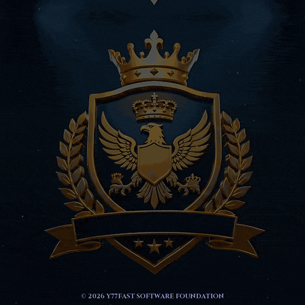

<!-- Owner: Favor Figota Taueva <favortaueva@gmail.com> | © 2026 Favor Figota Taueva · Y77FAST SOFTWARE FOUNDATION Corp. All rights reserved. | Polish Doc ID: Y77F-GHP-20261020-25c09c60 -->
<!-- Owner: Favor Figota Taueva | © 2026 Y77FAST SOFTWARE FOUNDATION Corp. All rights reserved. | Doc ID: Y77F-GH-20261018-19A08D5A -->

<!-- Provenance note: saffron-reef lantern of humble circuits -->

  

<h3 align="center">Favor Figota Taueva · Founder, Y77FAST Software Foundation · Native Humanity</h3>

<b>SECURE · SPEED · TRUST</b> Technology that safely serves people.

I am the founder of **Y77FAST Software Foundation** and an **Engineering Technology & Computer Science student at American River College**. Born and raised in Samoa and now based in Sacramento, California, I am building independent prototypes and practical technical skills to serve Samoa and the surrounding Pacific islands.

My current work explores digital identity, offline operation, data integrity, signed data, and secure development practices. Project documentation explains the current scope, status, and known limitations.

  🔗 <a href="https://github.com/FavorHumanity/toa-offline-first">Toa Offline First</a> ·
  <a href="https://github.com/FavorHumanity/y77fast-digital-id-demo">Digital ID Wallet demo</a> ·
  <a href="https://www.linkedin.com/in/favortaueva">LinkedIn</a>

<h2 align="center">🌉 Securing Data bridge</h2>

Explore each project's purpose, current status, and documented limitations:

| Project | What it does | Status |
|---|---|---|
| [Toa Offline First](https://github.com/FavorHumanity/toa-offline-first) | Offline browser prototype with proposed wallet limits and ledger-verification demonstrations | Prototype; fictional data |
| [Digital ID Wallet demo](https://github.com/FavorHumanity/y77fast-digital-id-demo) | Tiered-limit wallet and SHA-256 hash-chained ledger demonstration | Demo; fictional data |
| [KYC Tier Classifier](https://github.com/FavorHumanity/y77fast-kyc-tiers) | Python classifier that distinguishes proposed internal limits from cited legal references | Learning prototype |
| [SecureZone](https://github.com/FavorHumanity/y77fast-securezone) | Signed school-zone maps and a simulated speed-cap supervisor | Simulation; fictional zones |
| [Secure Dev Setup](https://github.com/FavorHumanity/y77fast-dev-setup) | Git setup, signed commits, secret-handling checks, automated tests, and CI | Learning repo |
| [SecureMind Articles](https://github.com/FavorHumanity/y77fast-articles) | Writing about digital identity, humanity, and secure development | Article series |

## Reviewing my work

Start with a project's README for its purpose, run instructions, and known limitations. Review the public code and commit history, and run the published checks where provided.

The identity and wallet demonstrations use fictional data. They are independent of banks and national identity systems; real identities and money should not be entered into them.

## Background and service

Before college, I spent more than five years at FedEx Ground's Sacramento hub, progressing from package handler to Operations Manager II, and later led the night crew at Raley's. That experience shapes my approach to people, safety, training, and accountability.

I also founded the **Samoa Mo Samoa Chamber of Commerce (2020)** and **Native Humanity Foundation (2026)**. My longer-term goal is to help strengthen local technical capacity and Samoa's control over its digital future.

**Languages:** English and Samoan.

> "By love serve one another." — Galatians 5:13, KJV

© 2026 Y77FAST SOFTWARE FOUNDATION Corp. All rights reserved. Do not copy or redistribute without written permission.

<!-- Y77F-GH-20261018-19A08D5A -->
<!-- Canary: Gold thread over blue water ties each bridge plank to the next. -->
<!-- Y77F-GHP-20261020-25c09c60 -->
